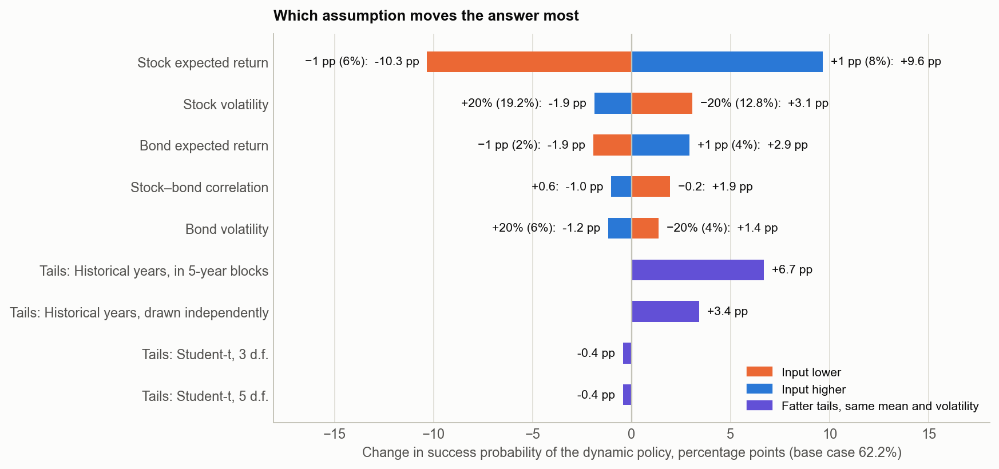
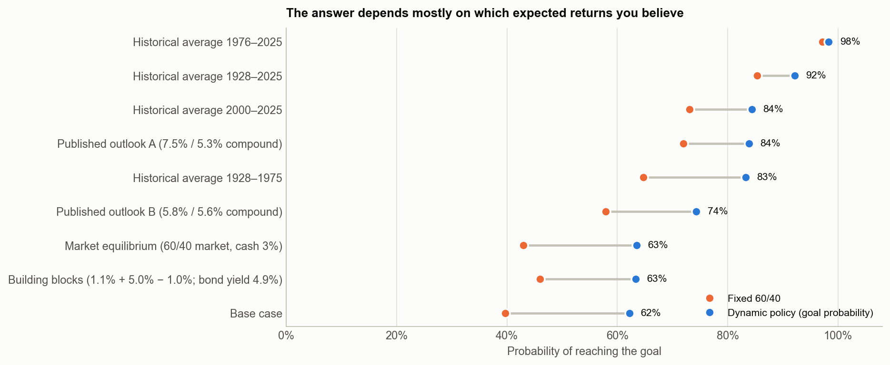
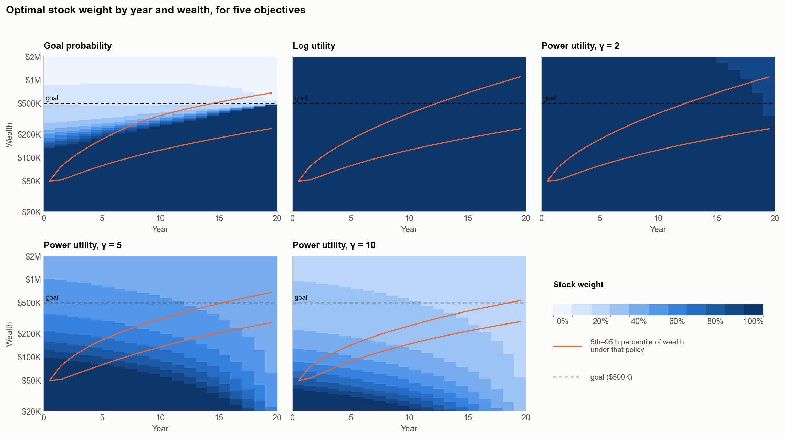
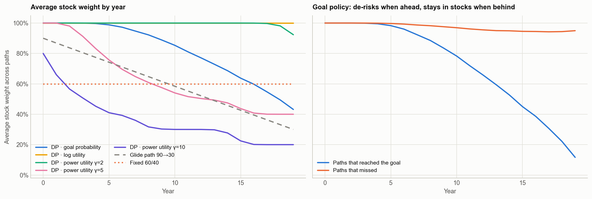
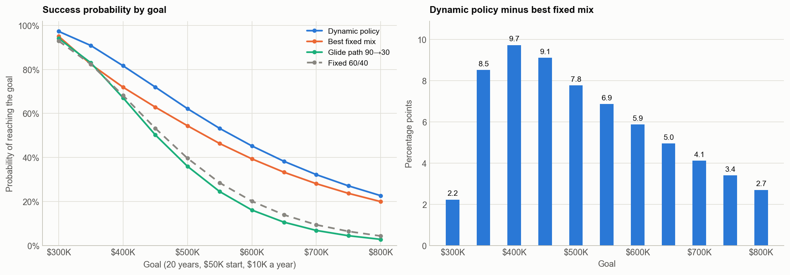
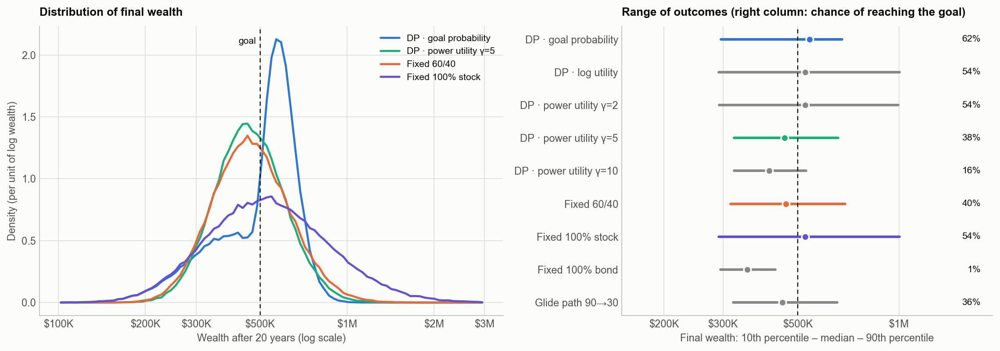
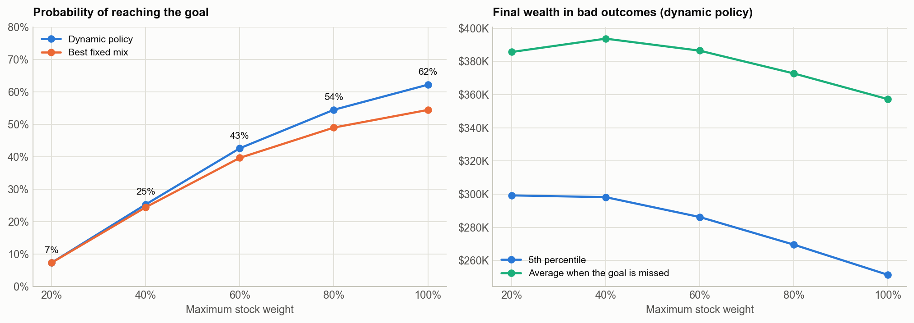
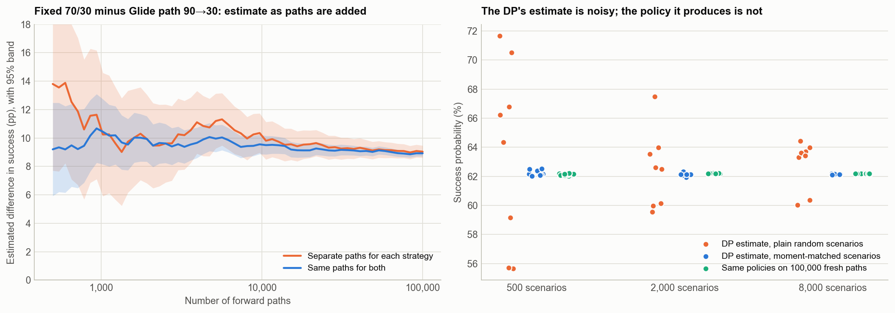

# Goals-based dynamic allocation

An investor has $50,000, saves $10,000 a year, and wants $500,000 in 20 years.
**How much should be in stocks each year — and how much does the answer depend on the return assumptions?**

This project solves that problem with dynamic programming, scores the result on
100,000 simulated paths against the usual static choices (60/40, all stocks, a
glide path), and then stress-tests every conclusion against the return
assumptions behind it.

The plan above needs 5.6% a year to land exactly on the goal. Under the base-case
assumptions stocks compound at about 5.8% and bonds at 2.9%, so this is a stretch
goal: reachable, but not safely.

> Everything below is "under these assumptions". The numbers are illustrations
> of a method, not investment advice.

## Why this problem

Mean-variance optimisation picks one set of weights for one period. Real
allocation decisions are made repeatedly, towards a target, and the right next
move depends on what has happened so far: an investor who is ahead of plan and
one who is behind should not hold the same portfolio. The same structure —
uncertain returns, a sequence of decisions, a target at the end — shows up in
several places:

| Setting | State | Target |
|---|---|---|
| Personal planning (education, house, retirement saving) | wealth, years left | reach an amount, or maximise expected utility |
| Retirement drawdown | wealth, years left, spending | not running out |
| Target-date fund design | years left (fixed path), plus wealth (dynamic path) | wealth distribution at retirement |
| Pensions, endowments | funding ratio, spending rule | stay funded, meet payouts |

Dynamic programming gives the policy: a stock weight for every year and every
wealth level. Monte Carlo then says what that policy is worth compared with
simpler rules.

## Results at a glance

Base case: stocks 7% expected return and 16% volatility, bonds 3% and 5%,
correlation 0.2, lognormal returns, yearly rebalancing, stock weight in steps of 10%.

| Strategy | Chance of reaching $500K | 10th pct | Median | 90th pct | Avg. stock weight |
|---|---|---|---|---|---|
| **Dynamic, maximise the chance of reaching the goal** | **62.2%** | $296K | $543K | $677K | 81% |
| Fixed 100% stock (the best fixed mix) | 54.4% | $292K | $527K | $1,003K | 100% |
| Fixed 60/40 | 39.7% | $316K | $461K | $692K | 60% |
| Glide path, 90% falling to 30% | 36.0% | $322K | $451K | $656K | 60% |
| Dynamic, power utility γ = 5 | 37.8% | $323K | $457K | $659K | 63% |

Standard error on each probability: 0.15 percentage points (pp). Full table:
[results/strategy_comparison.md](results/strategy_comparison.md).

Five findings, in order of importance:

1. **The expected stock return matters more than everything else combined.** One point less (6% instead of 7%) cuts the success probability from 62% to 52%. No other single parameter moves it by more than about 3 points. Across reasonable ways of setting expected returns the answer ranges from 62% to 98%.
2. **The policy is far more robust than the probability.** A policy optimised for the base case and then run in a world with different returns loses less than 1 point against a policy re-optimised for that world. The model is reliable on *what to do*; it is only as good as the forecast on *how likely it is to work*.
3. **A dynamic policy adds 7–10 points over the best fixed mix** for goals that are a stretch but reachable, and about 22 points over 60/40. In saving terms it is worth about $2,300 a year: reaching 75% takes $12,100 a year with the dynamic policy and $14,500 with 60/40.
4. **The objective is a decision, not a detail.** "Maximise the chance of reaching the goal" and "maximise expected utility" produce very different policies (62% vs 38% success, but $323K vs $296K at the 10th percentile). The goal-probability policy gives up the upside to buy probability, and keeps full stock risk for anyone who falls behind.
5. **A cap on the stock weight is expensive for this goal.** A maximum of 80% costs 8 points, 60% costs 20 points.

## 1. Return assumptions come first

### Which input matters

Each row changes one input, re-solves the policy, and re-runs the simulation.



| Input | Change | Dynamic policy | 60/40 |
|---|---|---|---|
| Base case | — | 62.2% | 39.7% |
| Stock expected return | −1 pp / +1 pp | 51.9% / 71.8% | 30.3% / 49.7% |
| Bond expected return | −1 pp / +1 pp | 60.3% / 65.1% | 33.3% / 46.3% |
| Stock volatility | +20% / −20% | 60.3% / 65.3% | 38.8% / 40.3% |
| Bond volatility | +20% / −20% | 61.0% / 63.5% | 39.6% / 39.7% |
| Stock–bond correlation | 0.6 / −0.2 | 61.2% / 64.1% | 39.4% / 39.9% |
| Fat tails (Student-t, 3 or 5 d.f., same mean and volatility) | — | 61.8% | 38.0% / 39.1% |
| Historical years, rescaled to base-case mean and volatility | independent / 5-year blocks | 65.6% / 68.9% | 41.1% / 41.0% |

Full table: [results/sensitivity.md](results/sensitivity.md).

What this means for a decision:

- **If the expected stock return is 1 point lower, the success probability falls from 62% to 52%.** To get back to 62% the investor has to save about $11,500 a year instead of $10,000 ([saving curve](results/saving_curve.md)). The expected return is also the input that is hardest to estimate.
- **Volatility and correlation matter much less**, and they are the inputs that can be estimated reasonably well. That is a convenient asymmetry to know about, not a comfort.
- **Fat tails barely move the success probability** when the mean and volatility are held fixed (−0.4 pp). Over 20 years the result depends on the centre of the distribution, not on single extreme years. Tails matter for *how bad* a miss is, not for *whether* the goal is met.
- **History-shaped returns help rather than hurt.** Resampling actual years from 1928–2025, rescaled to the same mean and volatility, raises the success probability by 3 points, and by 7 points when years are kept in blocks of five. Historical stock returns are skewed to the left, which at a fixed mean makes the typical year better; and over five-year spans they have varied less than independent years would (variance ratio 0.82). I would not count on the second effect, but it shows the lognormal base case is not flattering the result.

### The policy is robust; the probability is not

The table in [results/sensitivity.md](results/sensitivity.md) also reports the
base-case policy scored in each changed world. With stock returns at 6% it
reaches 51.9% — the same as a policy re-optimised for 6%. The largest loss from
planning on the wrong assumption is 0.9 points (bond return off by 1 point).

So the allocation rule can be used with some confidence even when the forecast
is uncertain. The quoted probability cannot: it should always be shown as a
range across return assumptions.

### Four ways to set expected returns



| Expected-return view | Stock / bond (compound) | Dynamic policy | 60/40 | Saving needed for 75% (dynamic) |
|---|---|---|---|---|
| Base case | 5.8% / 2.9% | 62.2% | 39.7% | $12,100 |
| Historical average 1928–2025 | 10.2% / 4.5% | 92.1% | 85.3% | $5,600 |
| Historical average 1928–1975 | 8.3% / 2.9% | 83.2% | 64.7% | $8,100 |
| Historical average 1976–2025 | 12.1% / 6.1% | 98.3% | 97.2% | $2,800 |
| Historical average 2000–2025 | 8.2% / 3.8% | 84.4% | 73.1% | $8,100 |
| Building blocks | 5.1% / 4.9% | 63.3% | 46.0% | $11,400 |
| Market equilibrium | 5.8% / 3.4% | 63.5% | 42.9% | $11,800 |
| Published outlook A | 7.5% / 5.3% | 83.9% | 72.0% | $8,600 |
| Published outlook B | 5.8% / 5.6% | 74.3% | 57.9% | $10,100 |

Full table with arithmetic means and volatilities:
[results/assumption_sets.md](results/assumption_sets.md).

- **Historical averages** depend heavily on the window: 83% to 98% for the same plan. They are also nominal and reflect one country's unusually good century.
- **Building blocks**: stocks = dividend yield + earnings growth + valuation change (1.1% + 5.0% − 1.0%); bonds = current 10-year Treasury yield (4.9%). The dividend yield (1.08% on 10 November 2026, [multpl.com](https://www.multpl.com/s-p-500-dividend-yield)) and the Treasury yield (4.84–4.98% over 2–10 November 2026, [US Treasury par yield curve](https://home.treasury.gov/resource-center/data-chart-center/interest-rates/TextView?type=daily_treasury_yield_curve&field_tdr_date_value_month=202611)) are observed. Earnings growth and valuation change are my own judgment inputs; change them in `run.py`.
- **Market equilibrium**: the returns that make a 60/40 market portfolio optimal for an investor with risk aversion 2.5 (the starting point of Black–Litterman), over a 3% cash rate.
- **Published outlooks**: compound returns taken from two asset managers' own pages, read on 10 November 2026.
  - *A*: [J.P. Morgan's 2027 Long-Term Capital Market Assumptions](https://am.jpmorgan.com/us/en/asset-management/adv/insights/portfolio-insights/ltcma/) (data as of September 2026, 10–15 year horizon) put US large-cap stocks at 7.5%. The US aggregate bond figure sits in a matrix behind a login, so the bond input is the 5.3% the public page gives for *global* aggregate bonds. The page does not say whether 7.5% is compound or arithmetic; I treat it as compound.
  - *B*: the [Vanguard Capital Markets Model](https://corporate.vanguard.com/content/corporatesite/us/en/corp/vemo/vemo-return-forecasts.html) run of 30 September 2026 gives 10-year ranges of 4.8–6.8% for US stocks and 5.1–6.1% for US aggregate bonds (geometric returns); I use the midpoints, 5.8% and 5.6%.
  - Both are paired with the base-case volatilities and correlation, not the publishers' own.
- **The base case sits at the cautious end**, mainly because its 3% bond return is well below today's yields. Outlook B has the same compound stock return as the base case (5.8%) and bonds at 5.6% instead of 2.9%; that alone lifts the dynamic policy from 62% to 74% and 60/40 from 40% to 58%.

One trap worth naming: forecasts are usually quoted as **compound** returns, while
simulations need **arithmetic** means. At 16% volatility the two differ by 1.2
points — the same size as the sensitivity above. Feeding a compound forecast in
as an arithmetic mean silently takes more than 10 points off the success probability.
`market.arithmetic_from_compound` does the conversion.

## 2. Dynamic against static



The top-left panel is the goal-probability policy. It holds 100% stocks while the
goal is far away, cuts risk quickly once wealth is on track, and is almost all in
bonds once the goal is secured. No fixed mix or pre-set glide path can do this,
because neither looks at wealth.



On average the stock weight falls from 100% to 43% over the 20 years, but the
average hides the point: paths that reached the goal ended with about 12% in
stocks, paths that missed were still about 95% in stocks.

**Where the advantage is largest:**



| Goal | Dynamic | Best fixed mix | Glide path | 60/40 | Dynamic − best fixed |
|---|---|---|---|---|---|
| $300K | 97.3% | 95.1% (30% stock) | 94.1% | 93.0% | +2.2 pp |
| $400K | 81.7% | 71.9% (100% stock) | 67.1% | 68.2% | +9.7 pp |
| $500K | 62.2% | 54.4% (100% stock) | 36.0% | 39.7% | +7.8 pp |
| $600K | 45.2% | 39.4% (100% stock) | 16.1% | 20.1% | +5.9 pp |
| $800K | 22.7% | 20.0% (100% stock) | 2.8% | 4.3% | +2.7 pp |

- The gain is largest (about 10 points) when the goal is ambitious but feasible — a dynamic success rate of roughly 70–90%. For an easy goal there is little to add; for a very hard one the best plan is "all stocks and hope", which a fixed mix can also do.
- **Horizon and funding pattern hardly matter** once the required return is held fixed: the gain is 7.3–8.1 points for 10, 20 and 30 years, and for lump-sum, mixed and savings-only plans ([table](results/dynamic_vs_static.md)).
- **The glide path does worse than 60/40** with the same average stock weight (36.0% vs 39.7%). It holds the most stock when the portfolio is small and the least when it is large, so its dollar exposure to stocks is lower. A glide path controls risk near the end date; it is not a way to reach a stretch goal.

## 3. Choosing the objective



| | Goal probability | Power utility γ = 5 | Log utility / γ = 2 |
|---|---|---|---|
| Policy shape | all stocks until on track, then lock in | more stock when wealth is low, less as it grows | 100% stock throughout |
| Chance of reaching $500K | 62.2% | 37.8% | 54.4% |
| 10th percentile of final wealth | $296K | $323K | $292K |
| Average wealth when the goal is missed | $357K | $394K | $364K |
| 90th percentile | $677K | $659K | $1,003K |
| Certainty equivalent at γ = 5 | $359K | $397K | $356K |

- **The goal-probability policy sells the upside.** Its 90th percentile is $677K against $1.0M for all stocks: once the goal is secured there is no reward for more. In exchange it adds 8 points of success with about the same downside as all stocks.
- **It does nothing for the paths that fall behind.** They stay fully in stocks to the end, and a miss lands at $357K on average against $389K for 60/40. An objective that only counts hits is indifferent to how large a miss is. In practice it needs a cap on risk (next section) or a blended objective.
- **Utility policies depend on wealth only because of the yearly saving.** Future savings act like a bond holding, so an investor with little financial wealth can hold more stock. Without contributions the policy is one constant weight — a property the test suite checks.
- With these return assumptions, log utility and γ = 2 want more than 100% in stocks, so the policy sits at the limit and equals the all-stock mix. γ = 5 behaves much like a wealth-aware glide path and ends close to 60/40.
- Each utility policy matches or beats every other strategy on the certainty equivalent under its own utility, which is what it was built to do.

## 4. What a cap on stocks costs



| Maximum stock weight | Dynamic policy | Cost of the cap | Best fixed mix under the cap | 5th percentile of final wealth |
|---|---|---|---|---|
| 100% | 62.2% | — | 54.4% | $251K |
| 80% | 54.5% | −7.7 pp | 49.0% | $270K |
| 60% | 42.6% | −19.6 pp | 39.7% | $286K |
| 40% | 25.3% | −36.9 pp | 24.4% | $298K |

A cap buys downside protection ($251K → $286K at the 5th percentile for a 60%
cap) at a steep price in success probability, because this goal needs equity
returns. It also removes most of the benefit of being dynamic: under a 60% cap
the dynamic policy is only 3 points ahead of a fixed 60/40. If a risk limit
applies, the honest conversation is about the goal or the saving rate, not the policy.

## 5. How much simulation is enough



**Forward paths.** One success probability near 62% has a standard error of
0.48 pp with 10,000 paths and 0.15 pp with 100,000. When comparing two
strategies, run both on the *same* paths: the standard error of the difference
drops from 0.22 pp to 0.06–0.13 pp, so pinning a difference to ±0.5 pp takes
5,000–27,000 paths instead of about 73,000
([table](results/mc_precision_paths.md)).

**DP scenarios.** The DP replaces the expectation by an average over sampled
return scenarios. With 2,000 plain random scenarios, the DP's *own* estimate of
the success probability ranged from 59.6% to 67.5% across eight draws — because
2,000 draws only pin the mean stock return down to about ±0.36 points, and finding
1 says what that does. Yet all eight policies scored 62.2% on fresh paths. Two
practical rules follow:

- Report the forward-simulated number with its standard error, never the DP's own estimate.
- Moment-match the scenario set (antithetic pairs, exact mean and variance of the shocks). The spread of the DP estimate drops from 2.6 pp to 0.1 pp ([table](results/mc_precision_dp.md)).

## Method

New to dynamic programming, or want to see the recursion run once by hand? [A three-period example](docs/worked_example.md) solves a tiny version of the problem on paper (62.5% against 50% for a fixed rule) and shows how it maps onto the full one.

- **State and action.** Wealth on a log-spaced grid of 300 points; stock weight in {0%, 10%, …, 100%}; yearly steps. Wealth evolves as `W' = W · (a · R_stock + (1 − a) · R_bond) + saving`.
- **Backward step.** `V_t(W) = max_a E[V_{t+1}(W')]`, with the expectation taken over 4,000 sampled return pairs that are shared by all actions and all years (common random numbers), and `V_{t+1}` read off the grid by interpolation. The last step uses the terminal reward directly, so the 0/1 goal payoff is never smoothed.
- **Objectives.** Probability of reaching the goal; power (CRRA) utility with γ = 2, 5, 10; log utility. Utility value functions are interpolated on the certainty-equivalent scale, which is nearly linear in wealth.
- **Forward step.** Every policy — DP tables, fixed mixes, glide path — runs on the same 100,000 fresh paths, drawn with a different seed from the DP scenarios, so reported numbers are out-of-sample.
- **Return models.** Lognormal; Student-t log returns matched to the same mean and volatility; block bootstrap of 1928–2025 annual S&P 500 and 10-year Treasury returns.

### How the engine is checked

I first checked the code on a simple two-outcome market where the answers can
be worked out by hand; the stock/bond problem then runs through the same solver.
`pytest` runs 59 checks, including:

- the three-period example: the engine reproduces every number in the hand calculation;
- the simple market: the optimal policy under log and power utility is one fixed mix at every date and wealth level and matches the closed-form weight; the sampled-expectation DP converges to the exact one; the goal-probability DP is bracketed between a lower and an upper bound, and forward simulation lands inside the bracket;
- no contributions → power and log utility policies are a single constant weight, equal to a direct one-period search;
- far above the goal → all bonds and success ≈ 100%; far below → all stocks;
- zero volatility → the simulation reproduces deterministic compounding to machine precision;
- saving more never lowers the success probability; a cap never raises it;
- the DP's estimate agrees with out-of-sample simulation (62.1% vs 62.2% ± 0.15%);
- each generator hits its target mean, volatility and correlation; the bootstrap keeps stock and bond returns paired and years consecutive within a block.

## Limitations and next steps

- **Nominal, pre-tax, no costs.** Inflation, taxes, fees and transaction costs are ignored. With trading costs the policy would get a no-trade band around its current weight.
- **Returns are independent across years inside the DP.** The block bootstrap tests the policy against serial dependence but the policy does not exploit it. A regime or valuation state would be the next state variable.
- **Parameter uncertainty is outside the optimisation.** The DP treats its assumptions as known; uncertainty enters only through the sensitivity tables. A robust version would optimise across several assumption sets at once.
- **Two assets, yearly rebalancing, 10% weight steps, no borrowing.**
- **Savings are certain** and the goal is all-or-nothing. A natural extension is a blended objective (probability of success plus a penalty on the size of a miss), which would address the behaviour in section 3.
- **History is one country, 98 years.** The bootstrap can only replay what is in that record.
- The same engine extends to retirement drawdown: change the sign of the yearly cash flow and make the target "wealth stays above zero".

## Run it

```bash
pip install -r requirements.txt
```

```bash
python -m pytest tests -q
```

```bash
python run.py
```

`python run.py` takes about four minutes on a 10-core laptop and rewrites every
table in `results/` and figure in `figures/`. `python run.py --only sensitivity`
runs one section; `python -m gbda.binomial` runs the simple-market check.

## Layout

```
gbda/
  dp.py          backward induction: objectives, scenarios, wealth grid, interpolation
  market.py      return assumptions and generators (lognormal, Student-t, block bootstrap)
  simulate.py    forward simulation of any policy (DP table, fixed mix, glide path)
  metrics.py     success probability and standard error, quantiles, certainty equivalent
  analysis.py    the investor problem and the experiments, parallel runner
  binomial.py    the simple two-outcome market used to check the engine
  worked_example.py  the three-period example, by hand and by the engine
  plots.py       shared chart style
run.py           runs every experiment; writes results/ and figures/
tests/           59 checks
docs/            worked_example.md: the recursion done by hand on a three-period problem
data/            annual US stock, bill and bond returns, 1928–2025 (source in data/SOURCE.md)
results/         tables (Markdown) and results.json with every number
figures/         charts used above; figures/validation/ for the simple market
```

## References

- Samuelson, P. (1969). Lifetime portfolio selection by dynamic stochastic programming. *Review of Economics and Statistics*.
- Merton, R. (1969). Lifetime portfolio selection under uncertainty: the continuous-time case. *Review of Economics and Statistics*.
- Das, S., Ostrov, D., Radhakrishnan, A., & Srivastav, D. (2020). Dynamic portfolio allocation in goals-based wealth management. *Computational Management Science*.
- Damodaran, A. Historical returns on stocks, bonds and bills, 1928–2025 (data).
