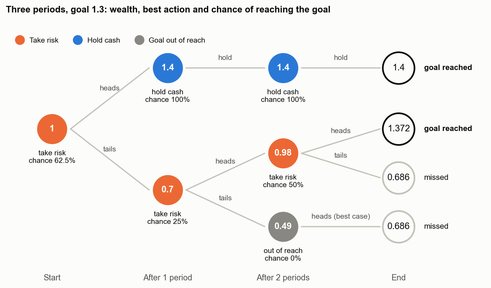

# How the dynamic program works: a three-period example

The full problem has 20 years, 300 wealth levels, 11 stock weights and 4,000
return scenarios. The logic is easier to see on a problem small enough to do on
paper. This one has three periods, two actions and a coin.

## The problem

- Start with wealth **1**. The goal is to end with at least **1.3** after three periods.
- Each period, choose one of two actions:
  - **hold cash** — wealth stays the same;
  - **take risk** — a fair coin: wealth × 1.4 on heads, × 0.7 on tails.
- Objective: make the **chance of reaching the goal** as large as possible.

Two obvious rules to compare against: always hold cash never gets there (0%).
Always take risk reaches 1.3 only with at least two heads out of three, which is
4 of the 8 coin sequences: **50%**.

## Solve it backwards

The trick of dynamic programming is to start at the end, where the answer is
obvious, and work back. At each date we fill in one number per wealth level:
`V(wealth)` = the chance of reaching the goal from here if we act optimally from now on.

For each action the rule is the same every time:

```
hold cash:  V_next(wealth)
take risk:  ½ · V_next(1.4 × wealth) + ½ · V_next(0.7 × wealth)
```

Take the larger of the two. That is the whole algorithm.

### Step 1 — the last decision (one period left)

After the last period the value is simply 1 if wealth ≥ 1.3 and 0 otherwise.

| Wealth | Hold cash | Take risk | Best | V |
|---|---|---|---|---|
| 1.96 | 1 | ½·1 + ½·1 = 1 | either | 1 |
| 1.4 | 1 | ½·1 + ½·0 = ½ | **hold cash** | 1 |
| 1 | 0 | ½·1 + ½·0 = ½ | **take risk** | ½ |
| 0.98 | 0 | ½·1 + ½·0 = ½ | **take risk** | ½ |
| 0.7 | 0 | ½·0 + ½·0 = 0 | either | 0 |
| 0.49 | 0 | 0 | either | 0 |

Reading the table: above the goal, stop. Just below it, one head is enough, so
take the risk. At 0.7 or lower even a head (0.98) is not enough: the goal is out of reach.

### Step 2 — one step earlier (two periods left)

Now `V_next` is the last column of the table above.

| Wealth | Hold cash | Take risk | Best | V |
|---|---|---|---|---|
| 1.4 | V(1.4) = 1 | ½·V(1.96) + ½·V(0.98) = ½·1 + ½·½ = ¾ | **hold cash** | 1 |
| 1 | V(1) = ½ | ½·V(1.4) + ½·V(0.7) = ½·1 + ½·0 = ½ | either | ½ |
| 0.7 | V(0.7) = 0 | ½·V(0.98) + ½·V(0.49) = ½·½ + ½·0 = ¼ | **take risk** | ¼ |

The first row is the key one. At 1.4 the investor is already above the goal.
Taking more risk would turn a certain success into a 75% chance, so the best
action is to stop.

### Step 3 — the first decision (three periods left)

| Wealth | Hold cash | Take risk | Best | V |
|---|---|---|---|---|
| 1 | V(1) = ½ | ½·V(1.4) + ½·V(0.7) = ½·1 + ½·¼ = **⅝** | **take risk** | ⅝ |

So the best achievable chance is **62.5%**, against 50% for always taking risk.

## The policy, read forwards



- **Start: take risk.** At 1 the goal cannot be reached without it.
- **After a head (1.4): lock in.** The goal is met; hold cash to the end.
- **After a tail (0.7): keep taking risk.** Two heads are now needed (0.7 → 0.98 → 1.372).
- **After two tails (0.49): the goal is out of reach** and the choice no longer matters.

The policy reaches the goal on 5 of the 8 coin sequences: the four that start
with a head, plus tails-heads-heads.

## Where the extra 12.5 points come from

Compare the two rules on the sequence **heads, tails, tails**:

| | After heads | After tails | After tails | Result |
|---|---|---|---|---|
| Always take risk | 1.4 | 0.98 | 0.686 | missed |
| Dynamic policy | 1.4 (stop) | 1.4 | 1.4 | reached |

That single sequence, one in eight, is the whole difference. The dynamic policy
does not pick better assets or forecast the coin. It wins by **stopping once it
is ahead**, which a rule that ignores wealth cannot do.

## From this example to the real problem

The stock/bond problem runs exactly the same recursion. What changes is size, and
two practical details that follow from it:

| | This example | The real problem |
|---|---|---|
| Periods | 3 | 20 years |
| Actions | 2 (cash or risk) | 11 stock weights, 0% to 100% |
| Outcomes per period | 2 (heads, tails) | 4,000 sampled stock/bond return pairs |
| Wealth levels | the handful that can occur | a grid of 300 points |
| Cash flows | none | $10,000 added each year |
| Expectation | ½ · … + ½ · … | average over the 4,000 scenarios |

- **Interpolation.** Here next-period wealth always lands on a level already in the table. With continuous returns it almost never lands on a grid point, so `V_next` is read by interpolating between neighbours.
- **Sampling.** Here the expectation is exact. With continuous returns it is an average over sampled scenarios, which is why the main results are always re-scored on fresh simulated paths.

The pattern in the answer carries over too. In the real problem the dynamic
policy reaches the goal 62% of the time against 54% for the best fixed mix, for
the same reason as here: it cuts risk once the goal is secured.

## When the coin changes: re-solve the rest

The table above was built for a coin that pays ×1.4 on heads. Suppose that after
the first period it turns out heads only pays **×1.3** from now on. The plan is
re-solved for the two periods that are left, starting from wherever wealth is.
The first period is over and plays no part.

With heads at ×1.3, the last-period threshold becomes 1.3 ÷ 1.3 = **1.0** (it was 0.929):

| Wealth after period 1 | Original table says | Re-solved table says | Why |
|---|---|---|---|
| 1.4 | hold cash, 100% | hold cash, 100% | already at the goal |
| 0.7 | take risk, **25%** | out of reach, **0%** | the best case is 0.7 × 1.3 × 1.3 = 1.183 < 1.3 (one head gives 0.91, below the new threshold 1.0) |

- **The action at 0.7 does not change.** The goal is out of reach either way, and taking risk is what the original table already said.
- **The forecast does.** The original table still promises 25% from 0.7, and 62.5% from the start. With the new coin the plan reaches the goal in 4 of 8 sequences (every sequence that starts with a head), so **50%**, whether the table is kept or re-solved.
- **Check:** re-solving at time 1 with the *old* coin gives back exactly the last two periods of the original table. That is the optimality principle, and a re-solve that fails it means a bug.

The same pattern shows up in the full problem: when the expected stock return
drops part-way through, re-solving changes the success probability by a fraction
of a point but corrects the plan's own forecast by more than ten points (README,
*When assumptions change*).

## Check it yourself

```bash
python -m gbda.worked_example
```

prints the three tables above next to the values the project's DP engine
computes for the same problem, then the re-solve with the ×1.3 coin, and redraws
the tree. `tests/test_worked_example.py` asserts that the hand tables and the
engine agree; `tests/test_changing_assumptions.py` checks the re-solve numbers.
