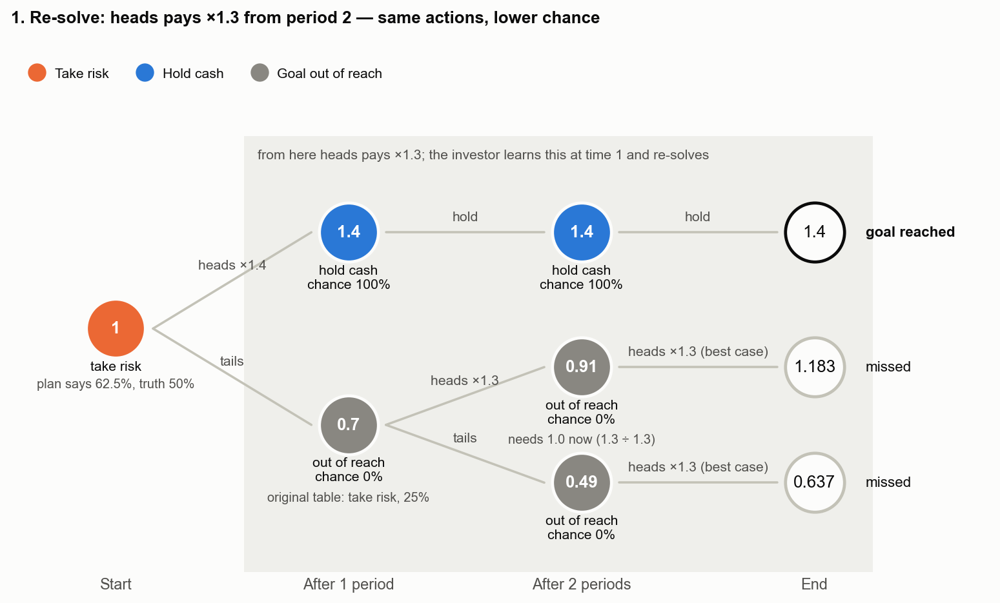
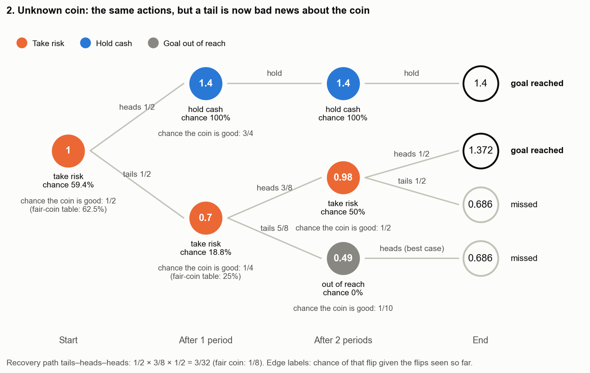
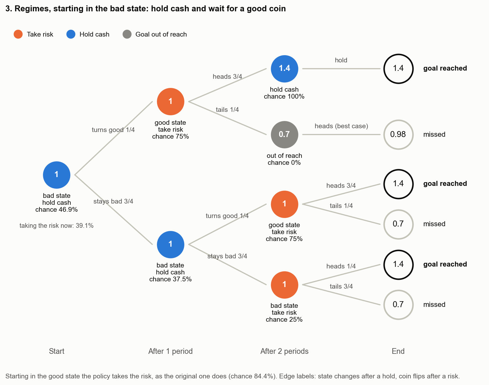

# When assumptions change: the three-period example, three ways

[The three-period example](worked_example.md) solves a tiny version of the
problem by hand:

- start with **1**, goal **1.3**, three periods;
- each period, hold cash or take a coin-flip risk (×1.4 on heads, ×0.7 on tails);
- with a fair coin the best policy reaches the goal **62.5%** of the time.

That policy is: take risk at the start; after a head (wealth 1.4), hold cash to
the end; after a tail (0.7), keep taking risk.

README section 6 tries three ways of handling return assumptions that change,
or were never known, on the 20-year problem. Here each one is done by hand on
the three-period problem, so every number can be checked on paper. Each method
is compared on two questions:

- **ignore it:** keep the original 62.5% policy;
- **handle it:** use the method;

and for each, *what actually happens* (the chance of reaching 1.3) and *what
the plan says will happen* (the chance its own table reports).

## 1. Re-solve: the coin gets worse halfway

**What changes.** From the second period on, heads pays **×1.3** instead of
×1.4. Tails still pays ×0.7 and the coin is still fair. The investor is told at
time 1, after the first flip, and solves the last two periods again, starting
from wherever wealth is. The first period is over and plays no part.

**Last period, new coin.** The threshold becomes 1.3 ÷ 1.3 = **1.0** (it was 0.929).

| Wealth | Best | V |
|---|---|---|
| 1.3 or more | hold cash | 1 |
| 1.0 to 1.3 | take risk | ½ |
| below 1.0 | out of reach | 0 |

**Two periods left, new coin.**

| Wealth | Hold cash | Take risk | Best | V | Original table said |
|---|---|---|---|---|---|
| 1.4 | 1 | ½·V(1.82) + ½·V(0.98) = ½ | hold cash | 1 | hold cash, 1 |
| 0.7 | 0 | ½·V(0.91) + ½·V(0.49) = 0 | out of reach | **0** | take risk, **¼** |

From 0.7 the best case is 0.7 × 1.3 × 1.3 = 1.183, below the goal.



The tree follows the re-solved policy on the true coin. Every action is the
one the original table would have taken. Only the 0.7 node changes its label:
from "take risk, 25%" to "out of reach, 0%".

**Four ways to run the plan.** All of them face the same true coin: ×1.4 in period 1, ×1.3 after that.

| Approach | Chance of reaching 1.3 | What it says the chance is |
|---|---|---|
| Keep the original table | 50% | 62.5% |
| Re-solve at time 1 | 50% | 50% |
| Re-solve one period late (time 2) | 50% | 62.5% until time 2, then 50% |
| Hindsight: knew about the change at time 0 | 50% | 50% |

- **The outcome is the same for all four.** Success needs a head in the first period (then hold cash). After a tail the goal is out of reach with the new coin, whatever is done, so the original table's "take risk" at 0.7 does no harm.
- **What re-solving fixes is the forecast.** The original table still says 62.5% (and ¼ from 0.7); the truth is 50% (and 0 from 0.7).
- **Check:** re-solving at time 1 with the *old* coin gives back exactly the last two periods of the original table. That is the optimality principle; a re-solve that fails it means a bug.

## 2. Parameter uncertainty: is it a good coin or a bad coin?

**What changes.** The coin is either **good** (heads with probability ¾) or
**bad** (heads ¼), each with probability ½. It is picked once before the first
period and kept for all three; nobody knows which one it is. A single flip is
still heads with probability ½ on average (½·¾ + ½·¼), as in the original
example. What is new is that the flips are now linked: a tail makes a bad coin
more likely, so the next flip is more likely to be a tail too.

In the 20-year model the coin is the expected stock return μ: drawn once, kept
for 20 years, never observed directly.

**Learning.** The coin is flipped every period whether or not the investor
takes the risk (the market moves either way), so every flip is information.
The investor updates by Bayes' rule. After one tail, for example, the chance of
a good coin is (½·¼) ÷ (½·¼ + ½·¾) = ¼.

| Flips seen so far | Chance the coin is good | Chance the next flip is heads |
|---|---|---|
| none | ½ | ½ |
| H | ¾ | ⅝ |
| T | ¼ | ⅜ |
| H H | 9/10 | 7/10 |
| H T or T H | ½ | ½ |
| T T | 1/10 | 3/10 |

The DP state becomes (time, wealth, flips seen so far).

**Solve backwards.** The steps are the same as before, except that "½" is
replaced by the chance of heads in the table above.

- **Last period.** At 0.98 (reached by T then H) take risk: the chance of heads after T H is ½, so V = ½. At 1.4 hold cash, V = 1. At 0.49 the goal is out of reach.
- **Two periods left, and the start:**

| Time | Wealth (flips seen) | Hold cash | Take risk | Best | Fair-coin table said |
|---|---|---|---|---|---|
| 1 | 0.7 (T) | 0 | ⅜ · ½ = **3/16** | take risk | take risk, ¼ |
| 0 | 1 (none) | ½ · ⅝ + ½ · ⅜ = ½ | ½ · 1 + ½ · 3/16 = **19/32** | take risk | take risk, ⅝ |

Holding cash at the start keeps wealth at 1, and then one head is needed at
time 1. After seeing H that happens with chance ⅝, after T with chance ⅜.



Same shape as the original tree, but the edge labels are now the chance of
each flip *given what has been seen*. After a tail the next flip is heads only
⅜ of the time. So the recovery tails–heads–heads has probability ½ · ⅜ · ½ =
3/32 instead of 1/8, which is where the 3 lost points go.

**Result.**

| Policy | Chance of reaching 1.3 | Good coin | Bad coin | What it says |
|---|---|---|---|---|
| Learns the coin | 59.4% | 89.1% | 29.7% | 59.4% |
| Ignores it (fair-coin table) | 59.4% | 89.1% | 29.7% | 62.5% |
| Always take risk | 50% | 84.4% | 15.6% | 50% |

- **Same policy, same outcome.** Learning changes no action on any path: take risk, lock in after a head, keep taking risk after a tail. Three flips are not enough for what is learned to change what is best.
- **The dynamic policy loses 3 points (62.5% → 59.4%); always taking risk loses nothing.** The dynamic policy's extra win was the sequence tail–head–head, a recovery after a bad start. A tail is now bad news about the coin, so that recovery is less likely: 3/32 instead of 1/8.
- **The range is wide.** With a good coin the plan succeeds 89% of the time, with a bad one 30%; 59.4% is the average of the two. The 20-year model shows the same at s = 2%: 28% to 88%.
- With two identical coins this is the original example again. In the 20-year model, s = 0 reproduces the base case exactly, and the tests check that.

## 3. Regimes: the coin switches, and you can see it

**What changes.** Each period the market is in a **good** state (heads ¾) or a
**bad** state (heads ¼), and the investor sees which one before deciding. Next
period the state stays the same with probability ¾ and switches with
probability ¼. The first state is good or bad with probability ½. Over time half
the periods are good and half bad, so a single flip is again heads with
probability ½ on average.

The difference from method 2: there the coin never changes but is never seen;
here it changes, but is always seen.

One number used below: seen from today, the chance that *next* period's flip
is heads is ⅝ if today is good (¾·¾ + ¼·¼) and ⅜ if today is bad.

The DP state becomes (time, wealth, today's state).

**Last period.** As in the original example, except that the chance of heads
depends on the state. Between 0.929 and 1.3, take risk: V = ¾ in a good state,
¼ in a bad one.

**Two periods left.**

| Wealth | State | Hold cash | Take risk | Best | V |
|---|---|---|---|---|---|
| 1.4 | either | 1 | less than 1 | hold cash | 1 |
| 1 | good | ⅝ | ¾ | take risk | ¾ |
| 1 | bad | ⅜ | ¼ | **hold cash** | ⅜ |
| 0.7 | good | 0 | ¾ · ⅝ = 15/32 | take risk | 15/32 |
| 0.7 | bad | 0 | ¼ · ⅜ = 3/32 | take risk | 3/32 |

The row "1, bad" is new. Taking the risk now needs a head from a bad coin (¼).
Holding cash waits one period and takes the risk then, with whatever state
comes (⅜). Waiting for a better coin beats betting on a bad one.

**The first decision.**

| State | Hold cash | Take risk | Best | V |
|---|---|---|---|---|
| good | ¾·¾ + ¼·⅜ = 21/32 | ¾·1 + ¼·(¾·15/32 + ¼·3/32) = 27/32 | take risk | **27/32 = 84.4%** |
| bad | ¼·¾ + ¾·⅜ = 15/32 | ¼·1 + ¾·(¼·15/32 + ¾·3/32) = 25/64 | **hold cash** | **15/32 = 46.9%** |

In the bad state the investor starts in cash and waits for a good state. The
20-year model does the same: in its bad state the policy holds mostly bonds,
even when behind.



The tree starts in the bad state. The investor holds cash, takes the risk as
soon as the state turns good, and in the last period takes it whatever the
state, because waiting longer is no longer possible. Starting in the good
state, the policy is the original one.

**Result.**

| Policy | Starts good | Starts bad | Either (½ each) | What it says |
|---|---|---|---|---|
| Sees the state | 84.4% | 46.9% | 65.6% | 84.4% / 46.9% |
| Ignores it (fair-coin table) | 84.4% | 39.1% | 61.7% | 62.5% |
| Gain | 0 | +7.8 pp | **+3.9 pp** | |

- **Here the policy changes, and so does the outcome.** Today's state says something about this period's flip and, because states persist, about the next one too. That is enough to change the best action now.
- Starting in a good state both policies take the risk, so there is no difference. All the gain comes from not betting on a bad coin.
- **Getting the persistence wrong costs nothing here.** Planning as if states did not persist (stay with probability ½) still holds cash in the bad state at the start, and still reaches 65.6%. In the 20-year model a wrong persistence costs 0.1–0.7 points.
- **The catch: the investor sees the state.** If it had to be guessed from past flips, the problem would look more like method 2, and the gain would shrink.

## Side by side

| | Original example | 1. Re-solve | 2. Parameter uncertainty | 3. Regimes |
|---|---|---|---|---|
| What is different | fair coin, known | heads pays ×1.3 from period 2; told at time 1 | coin good or bad for all 3 periods; never seen | coin good or bad each period; seen; stays with probability ¾ |
| What the DP also tracks | — | nothing (solve again) | flips seen so far | today's state |
| Ignore it: chance of reaching 1.3 | 62.5% | 50% | 59.4% | 61.7% |
| Handle it: chance of reaching 1.3 | — | 50% | 59.4% | **65.6%** |
| Gain from handling it | — | 0 | 0 | **+3.9 pp** |
| Does the policy change? | — | no | no | **yes:** bad state → hold cash and wait |
| What ignoring it says | 62.5% | 62.5% | 62.5% | 62.5% |
| What handling it says | — | 50% | 59.4% | 84.4% (good) / 46.9% (bad) |
| The same in the 20-year model | 62.2% | +0.2 pp; forecast 62% → 51% | ±0.03 pp; 28–88% across μ | +2.6 pp |

What the three-period versions show:

1. **A method improves the outcome only if it tells the policy something that changes what to do now.** Re-solving and learning do not: the best action is the same either way. Seeing the market state does: in a bad state, wait.
2. **All three fix what the plan says.** Ignoring the change, the plan keeps saying 62.5%. In method 1 that is 12.5 points too high, in method 2 three points. In method 3 the average is about right (62.5% against 61.7%), but it hides that the real chance is 84% or 47% depending on today's state.
3. **The pattern is the same as in the 20-year model.** Re-solving and learning change the forecast; regimes change the policy, provided the state can be seen.

## Check it yourself

```bash
python -m gbda.worked_changes
```

prints every table on this page as exact fractions and redraws the three
trees. `tests/test_worked_changes.py`
checks each number against the project's DP engine solving the same problems
(per-year coins for method 1, a second state variable for methods 2 and 3).
